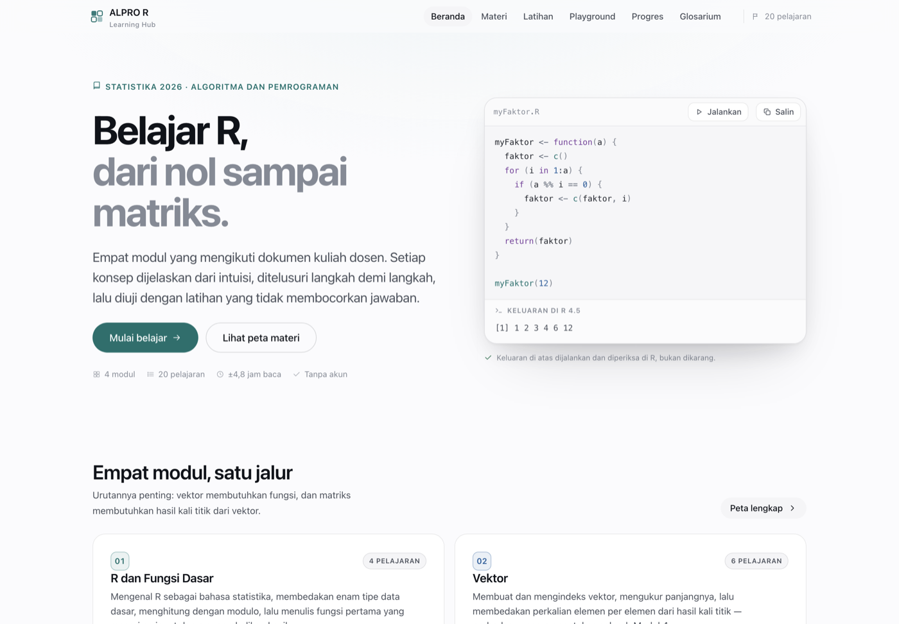

# ALPRO R Learning Hub

Situs pembelajaran untuk mata kuliah **Algoritma dan Pemrograman (R)**,
Program Studi Statistika angkatan 2026. Dibuat sebagai media pendamping
asistensi: empat modul, 20 pelajaran, 85 latihan, glosarium, dan playground R
yang berjalan langsung di browser.

Tidak ada akun, tidak ada server, tidak ada pelacakan. Seluruh situs adalah
berkas statis.



---

## Menjalankan

**Cara termudah (macOS):** klik dua kali `Mulai Website.command`. Berkas itu
menjalankan server lokal dan membuka browser.

**Cara manual:**

```bash
cd "Website Alpro"
python3 -m http.server 8080
# lalu buka http://localhost:8080
```

Situs memakai ES Module, jadi harus dibuka lewat `http://` — membuka
`index.html` langsung dari Finder (protokol `file://`) tidak akan bekerja
karena browser memblokir impor modul.

Untuk menghentikan server, tekan `Ctrl+C` di Terminal.

---

## Tema

Tombol tema ada di kanan navbar. Ada tiga pilihan: **Ikut sistem** (bawaan),
**Terang**, dan **Gelap**. Pilihan disimpan di `localStorage` dan dipasang
sebelum halaman digambar oleh skrip kecil di `index.html`, sehingga tidak ada
kedipan tema terang ketika sistem memakai mode gelap. Selama mode "ikut
sistem", perubahan tema OS langsung diikuti tanpa memuat ulang halaman.

---

## Struktur berkas

```
index.html                 kerangka halaman (nav, main, footer diisi oleh JS)
Mulai Website.command      peluncur server lokal untuk macOS

assets/css/
  tokens.css               warna, tipografi, jarak, radius, bayangan, gerak
  base.css                 reset, tipografi dasar, fokus, utilitas
  layout.css               navbar, sidebar, footer, grid
  components.css           tombol, kartu, blok kode, callout, latihan, tracing
  pages.css                beranda, modul, playground, progres, glosarium

assets/js/
  app.js                   titik masuk: merutekan halaman, memasang interaksi
  router.js                perutean berbasis hash (#/modul/vektor/...)
  store.js                 progres di localStorage
  ui.js                    pembantu DOM, teks kaya, ikon, notifikasi
  highlight.js             penyorotan sintaks R
  components/              blok materi, kartu, latihan, kerangka navigasi
  pages/                   satu berkas per halaman
  r/interpreter.js         penafsir subset R (tokenizer → parser → evaluator)
  r/interpreter.test.mjs   uji penafsir (84 tes)
  r/README.md              dokumentasi subset R yang didukung

content/
  curriculum.js            menggabungkan keempat modul
  module1.js … module4.js  materi lengkap per modul
  exercises.js             bank soal gabungan + pembantu penilaian
  exercises1.js            soal modul 1–2
  exercises2.js            soal modul 3–4
  glossary.js              istilah glosarium

tools/
  browser.mjs              kendali Chrome via DevTools Protocol
  verify.mjs               pemeriksaan penerimaan otomatis (40 pemeriksaan)
```

---

## Memperbarui materi

Semua materi adalah data JavaScript, bukan HTML. Untuk mengubah teks, cukup
sunting berkas di `content/`.

### Menambah atau mengubah pelajaran

Setiap pelajaran berbentuk objek di dalam `content/moduleN.js`:

```js
{
  id: 'nama-pendek',            // dipakai di URL
  title: 'Judul pelajaran',
  desc: 'Satu kalimat untuk daftar isi',
  duration: 14,                 // menit, perkiraan
  level: 2,                     // 1 dasar … 4 tantangan
  objectives: ['...'],          // ditampilkan di kartu tujuan belajar
  prereq: ['...'],
  blocks: [ ... ],              // isi pelajaran
  summary: ['...'],             // rangkuman
  mistakes: ['...'],            // kesalahan umum
}
```

`blocks` berisi urutan blok. Jenis yang tersedia:

| `t` | Isi |
|---|---|
| `p`, `lead` | Paragraf biasa / paragraf pembuka yang lebih besar |
| `h2`, `h3` | Subjudul di dalam pelajaran |
| `ul`, `ol` | Daftar |
| `code` | Blok kode: `{ code, out, label, outLabel }` |
| `table` | Tabel: `{ head: [], rows: [[]], caption }` |
| `callout` | Kotak catatan: `{ tone: 'note'|'warm'|'danger'|'plain', title, text }` |
| `steps` | Langkah bernomor: `{ items: [{ title, text }] }` |
| `trace` | Tabel tracing: `{ title, cols, rows, note }` |
| `vizvec` | Visualisasi vektor yang bisa diklik: `{ values, caption }` |
| `vizmat` | Visualisasi matriks: `{ rows, caption }` |

Di dalam teks, markup yang dikenali hanya `**tebal**`, `` `kode` ``, dan
`*miring*`. Semua teks di-escape sebelum dirender.

Pada blok `code`, `out` adalah keluaran **R 4.5 yang sebenarnya**, bukan
keluaran simulator. Tombol "Jalankan" mengirim blok itu beserta contoh
sebelumnya ke playground. Dua opsi tambahan:

- `run: false` — sembunyikan tombol "Jalankan" (untuk kode yang memakai fitur
  di luar subset, misalnya `sessionInfo()` atau bilangan kompleks).
- Blok pseudocode memakai `plain: true` sehingga tidak disorot sebagai R.

### Menambah latihan

Tambahkan objek ke `content/exercises1.js` atau `exercises2.js`:

```js
{
  id: 'm2-l4-e9',                 // unik
  module: 'vektor',
  lesson: 'operasi-vektor',
  type: 'choice',                 // choice | predict | short | debug | code
  level: 3,
  prompt: 'Pertanyaan…',
  code: 'kode R yang ditampilkan',  // opsional
  options: ['…'],                 // untuk choice / debug
  answer: 1,                      // indeks (choice/debug) atau daftar teks
  hints: ['petunjuk 1', 'petunjuk 2'],
  explanation: 'Pembahasan…',
  solution: '…',                  // wajib untuk type: 'code'
}
```

Soal `choice`, `debug`, `predict`, dan `short` dinilai otomatis. Jawaban teks
dibandingkan tanpa peka huruf besar-kecil, spasi, dan koma — sehingga
`4, 10, 18` dianggap sama dengan `4 10 18`. Soal `code` tidak dinilai otomatis
karena banyak bentuk jawaban yang sama-sama benar; siswa membandingkan sendiri
dengan solusi rujukan.

---

## Ketepatan materi

- Seluruh keluaran kode di halaman materi diambil dari **R 4.5.2** dan
  diperiksa ulang dengan menjalankan setiap blok.
- Beberapa keluaran sengaja **tidak** disamakan dengan format simulator
  (misalnya peringatan pendaurulangan yang di R tercetak dengan awalan
  `Warning message:`), karena materi mengutip R yang sebenarnya.
- Dua ketidaksesuaian pada dokumen kuliah tidak diubah diam-diam, melainkan
  dijelaskan di pelajaran terkait dan di halaman **Tentang**:
  1. rumus iterasi `x(k+1) = e^x(k)` kehilangan tanda minus (kodenya benar:
     `-exp(x0)`);
  2. nama kolom `GaPok`/`Gapok` seharusnya `GajiPokok`.

### Playground

Playground memakai penafsir subset R sendiri (`assets/js/r/interpreter.js`),
bukan R. Yang didukung: vektor, fungsi, percabangan, loop, matriks, array,
data frame sederhana, dan sebagian besar fungsi yang dipakai di keempat modul.
Yang **tidak** didukung: paket, grafik, berkas, bilangan kompleks, `sapply`,
dan fungsi statistik seperti `mean`/`sd`. Halaman playground menyatakan batas
ini secara terbuka, dan tidak ada tombol "Jalankan" yang berpura-pura.

---

## Pengujian

```bash
# uji penafsir R (84 tes)
node --test assets/js/r/interpreter.test.mjs

# pemeriksaan penerimaan situs (40 pemeriksaan; perlu Chrome + server lokal)
python3 -m http.server 8811 &
node tools/verify.mjs http://localhost:8811
```

`tools/verify.mjs` memeriksa semua rute, galat konsol, umpan balik latihan,
penyimpanan progres, eksekusi playground, pengaman loop tak berujung,
penyaring bank soal, glosarium, tema gelap, luapan horizontal pada empat lebar
layar, dan menu seluler. Skrip ini memakai Chrome melalui DevTools Protocol
dan hanya untuk pengembangan — tidak dipakai oleh situs.

---

## Batasan yang diketahui

- Progres disimpan per perangkat lewat `localStorage`; tidak ada sinkronisasi
  antarperangkat dan tidak ada akun.
- Penomoran halaman memakai hash (`#/modul/...`) agar dapat dihosting di
  layanan statis mana pun tanpa aturan penulisan ulang.
- Belum ada mode asisten terpisah, bank soal adaptif, atau papan peringkat.
  Prioritas versi ini adalah ketepatan materi dan latihan.
